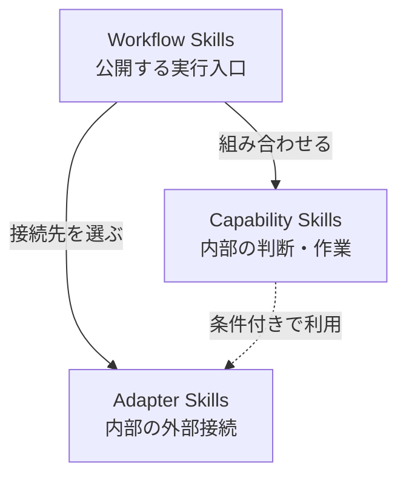

# Composable Skill Architecture

このリポジトリでは、Codex Skillを次の3層に分ける。



矢印は処理の実行順ではなく、依存する方向を表す。Capability同士の依存と、Adapterから他のSkillへの依存は禁止する。CapabilityからAdapterへの依存は、後述の条件をすべて満たす場合だけ許可する。

## Layers

- **Workflow**: Codexが発見する実行入口。ユースケースに必要なSkillを選び、順序、停止、結果の統合を扱う。
- **Capability**: Workflowから読み込まれ、調査、判断、変換、生成、検証など、ツール非依存で再利用可能な能力を提供する。
- **Adapter**: Workflowまたは条件を満たすCapabilityから読み込まれ、外部ツールやサービスなど、具体的な技術との接続を扱う。

各Skillは所属する層のディレクトリに配置する。

```text
skills/
|-- workflows/
|-- capabilities/
`-- adapters/
```

WorkflowはCapabilityとAdapterへ依存できる。Capability同士の依存とWorkflow同士の依存は禁止する。CapabilityからAdapterへの依存は条件付きで許可する。Adapterは他のSkillへ依存しない。Capabilityの実行順と結果の受け渡しはWorkflowが管理する。循環依存は禁止する。

CodexのSkill探索対象へインストールするのはWorkflowだけとする。CapabilityとAdapterはこのリポジトリを正本とする内部Skillであり、ユーザーの依頼から直接起動しない。

## Composition rules

Codex Skill間に関数呼び出しを仮定しない。Workflowは必要な内部Skillを名前で示し、このリポジトリにある定義を読み込んで組み合わせる。

- CapabilityとAdapterは、ユーザー向けのSkillとして公開または直接起動しない。
- Capabilityは他のCapability名を参照しない。前段の結果が必要な場合は、生成元を限定せず必要な情報として受け取る。
- CapabilityがAdapterへ依存する場合も、具体的なツール操作はAdapterへ委ねる。

### CapabilityからAdapterへの依存

次の条件をすべて満たす場合だけ許可する。

1. Adapter利用がCapabilityの本質的な一部である。
2. WorkflowごとにAdapterを差し替える必要がない。
3. Adapterが処理順や業務判断を持たない。
4. Capability名や責務が、外部技術への依存を隠していない。

1つでも満たさない場合は、CapabilityからAdapterを参照せず、WorkflowがAdapterを選択する。

## Intermediate JSON

Skill間の受け渡しや成果物の変換のために生成した中間JSONは、ディスクへ保存しない。一時ファイル、キャッシュ、失敗時の退避ファイルも作らない。既存のSchema、設定、固定のテスト資産、および依頼された実装の一部となるJSONファイルは中間JSONに含めない。

- Workflowは生成したJSONをメモリ上で扱い、後続のコマンドへUTF-8の標準入力で渡す。ファイルへ保存してから削除する方式は使わない。
- CapabilityとAdapterは中間JSONのファイルを要求・生成せず、受け取ったデータをメモリ上で処理する。
- 外部ツールがファイル入力を要求する、または内部で中間JSONを保存する場合は、その操作を実行せず非対応として返す。Workflowが利用可能な成果物と未完了部分を報告する。

この方針はローカルの中間JSONファイルに対する制約であり、会話履歴や実行基盤のログ保存を制御するものではない。
