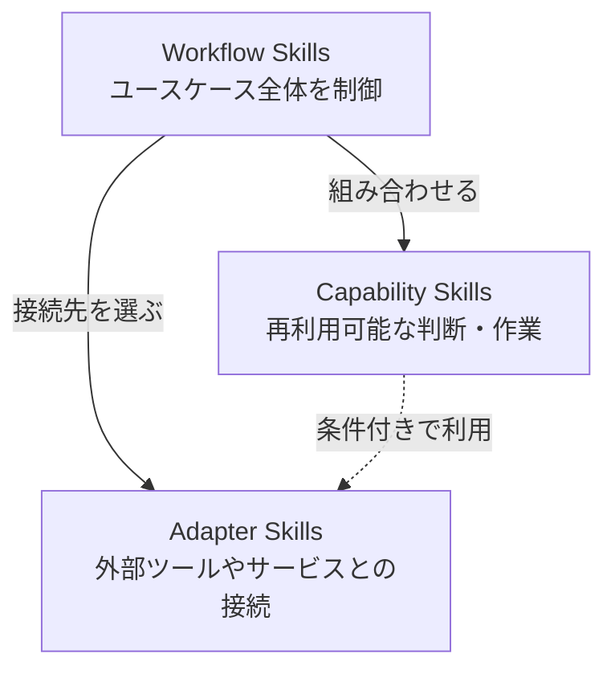

# Composable Skill Architecture

このリポジトリでは、Codex Skillを次の3層に分ける。



矢印は処理の実行順ではなく、依存する方向を表す。Capability同士の依存と、Adapterから他のSkillへの依存は禁止する。CapabilityからAdapterへの依存は、後述の条件をすべて満たす場合だけ許可する。

## Layers

- **Workflow**: ユースケースに必要なSkillを選び、順序、停止、結果の統合を扱う。
- **Capability**: 調査、判断、変換、生成、検証など、ツール非依存で再利用可能な能力を提供する。
- **Adapter**: 外部ツールやサービスなど、具体的な技術との接続を扱う。

各Skillは所属する層のディレクトリに配置する。

```text
skills/
|-- workflows/
|-- capabilities/
`-- adapters/
```

WorkflowはCapabilityとAdapterへ依存できる。Capability同士の依存とWorkflow同士の依存は禁止する。CapabilityからAdapterへの依存は条件付きで許可する。Adapterは他のSkillへ依存しない。Capabilityの実行順と結果の受け渡しはWorkflowが管理する。循環依存は禁止する。

## Composition rules

Codex Skill間に関数呼び出しを仮定しない。Workflowは利用するSkillを名前で示し、Codexが利用可能なSkillから選択する。

- CapabilityはWorkflow経由でも直接でも起動できる。
- Capabilityは他のCapability名を参照しない。前段の結果が必要な場合は、生成元を限定せず必要な情報として受け取る。
- CapabilityがAdapterへ依存する場合も、具体的なツール操作はAdapterへ委ねる。

### CapabilityからAdapterへの依存

次の条件をすべて満たす場合だけ許可する。

1. Adapter利用がCapabilityの本質的な一部である。
2. WorkflowごとにAdapterを差し替える必要がない。
3. Adapterが処理順や業務判断を持たない。
4. Capability名や責務が、外部技術への依存を隠していない。

1つでも満たさない場合は、CapabilityからAdapterを参照せず、WorkflowがAdapterを選択する。
