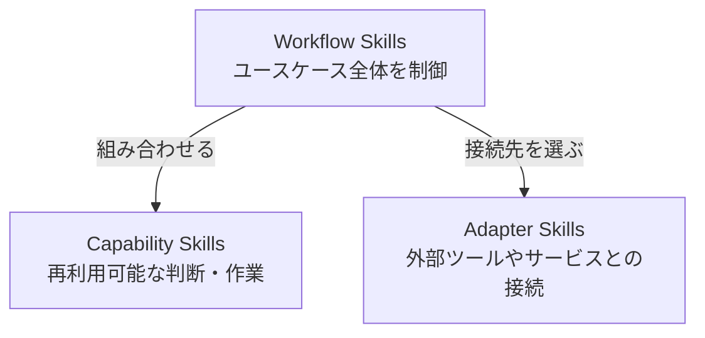

# Composable Skill Architecture

このリポジトリでは、Codex Skillを次の3層に分ける。

矢印は処理の実行順ではなく、依存する方向を表す。Capability同士の再利用は許可するが、Capabilityから具体的なAdapterへの依存は禁止する。

## Layers

- **Workflow**: ユースケースに必要なSkillを選び、順序、停止、結果の統合を扱う。
- **Capability**: 調査、判断、変換、生成、検証など、ツール非依存で再利用可能な能力を提供する。
- **Adapter**: 外部ツールやサービスなど、具体的な技術との接続を扱う。

WorkflowはCapabilityとAdapterへ依存できる。Capabilityは他のCapabilityへ依存できるが、Adapterへ依存してはならない。Adapterは他のSkillへ依存しない。循環依存は禁止する。

## Composition rules

Codex Skill間に関数呼び出しを仮定しない。Workflowは利用するSkillを名前で示し、Codexが利用可能なSkillから選択する。

- CapabilityはWorkflow経由でも直接でも起動できる。
- Capabilityは特定ツールの操作方法を持たず、必要な操作と期待結果だけを表現する。
