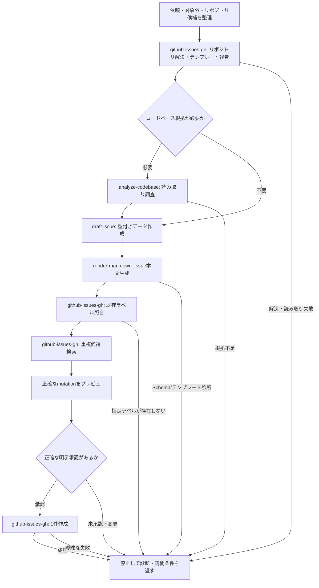

# Create GitHub Issue

ユーザーの依頼を、正確なリポジトリ、タイトル、本文、任意の既存ラベルを持つ1件のGitHub Issueへ変換する公開Workflow。読み取り、下書き、プレビュー、明示的な承認、作成の順序を管理する。

## Internal Skills

このWorkflowの `SKILL.md` を含むディレクトリがsymlinkまたはJunctionの場合は、最初にリンク先の実体ディレクトリを解決する。見かけのパスに対して相対パスを解決しない。

実体ディレクトリを基準に、次の内部Skillを必要な順に読み込む。

- `../../capabilities/analyze-codebase/SKILL.md`（コードベース根拠が必要な場合だけ）
- `../../capabilities/draft-issue/SKILL.md`
- `../../capabilities/render-markdown/SKILL.md`
- `../../adapters/github-issues-gh/SKILL.md`

これらをユーザー向けSkillとして直接起動せず、Capability同士を参照させない。必要なSkillが存在しない、または読めない場合はパスを報告して停止する。

## Scope

- 1回の実行で作成するIssueは1件だけとする。
- 作成対象はタイトル、本文、任意の既存ラベルだけとする。
- Issueの編集、クローズ、再オープン、ラベル作成、ラベル変更、assignee、milestone、project、parent、sub-issueは対象外とする。
- 作成コマンドは、ユーザーがプレビューに含まれる正確なリポジトリ、タイトル、本文、ラベルを明示的に承認した場合だけ1回実行する。

## Flow

## Workflow

### 1. 依頼と対象を整理する

ユーザーの意図、対象リポジトリ、任意のラベル名、コードベース根拠の要否を整理する。リポジトリが省略された場合は現在の作業ディレクトリを候補にするが、作成承認までは認可済みとは扱わない。今回の処理で扱うのは1件の作成だけであることを明示する。

次のいずれかに該当する場合だけ、コードベース根拠を必要と判定する。

- 現在の実装、既存の処理経路、ファイル、シンボル、既存テストへの言及がある。
- 「既存パターンに従う」「リポジトリ規約を調べる」「互換性を確認する」など、現在のリポジトリから事実を取得する必要がある。
- 受け入れ条件、検証方法、対象範囲を確定するために、ユーザーが与えた情報だけでは不足している。

それ以外では `analyze-codebase` を実行しない。ユーザーが渡した根拠と規約だけを `draft-issue` へ渡し、不足事項を創作しない。

### 2. リポジトリを解決し、テンプレートを報告する

`github-issues-gh` へ `repositoryRef` を渡し、正規の `nameWithOwner` とURL、Issue機能の有効状態、既存のIssueテンプレート情報を受け取る。テンプレートの名前や説明をユーザーへ報告する。テンプレートが存在しないことは失敗ではなく、本文はこのWorkflowが所有する開発Issue形式で作る。

リポジトリが解決できない、Issue機能が無効、または権限・認証により読み取れない場合は、下書きや作成へ進まず診断を返す。

### 3. 必要な根拠を調査し、型付きデータを作る

根拠が必要な場合だけ `analyze-codebase` を読み取り専用で実行し、確認済みの実装経路、制約、既存パターン、関連テスト、検証コマンドを受け取る。未確認の推測は下書きへ渡さない。

`draft-issue` へ次を渡す。

- `userIntent`
- 任意の `codebaseEvidence`
- リポジトリから確認できた、またはユーザーが提示した `repositoryConventions`

返されたJSONが開発Issueの型付きデータであることを確認し、少なくともタイトル、背景、目的、受け入れ条件、対象範囲、対象外、検証を含める。下書きが不足情報を示した場合は、推測で補完せず停止する。

### 4. 固定資産から本文を描画する

Workflowが所有する次の絶対パスを `render-markdown` に渡す。

- `assets/development-issue/schema.json`
- `assets/development-issue/template.md`

下書きJSONを標準入力または一時入力として渡し、本文を標準出力へ生成する。Schema、テンプレート、下書きJSONはいずれも変更しない。診断が返った場合は本文を採用せず、入力データまたはWorkflow資産を修正できる情報として停止する。同じ不正入力を盲目的に再実行しない。

### 5. ラベルと重複候補を読み取る

`github-issues-gh` で既存ラベルを取得する。ユーザーが指定したラベルがある場合は、名前の完全一致で既存ラベルに含まれることを確認する。1つでも存在しなければ停止し、ラベルを作成したり別ラベルへ置き換えたりしない。未指定の場合は空配列を作成入力にする。

描画済みのタイトルを使って、状態を限定せず重複候補を検索する。検索結果は候補としてそのまま報告する。候補が見つかった場合に自動で重複と断定したり、自動で作成を取りやめたりせず、候補を含むプレビューでユーザーの判断を求める。

### 6. 正確なmutationをプレビューして承認を得る

次の4項目を、作成時に渡す値と同じ内容でプレビューする。

- 正規の `repository`（`nameWithOwner`）
- `title`
- レンダリング済みの完全な `body`（改行を含む）
- 既存確認済みの `labels`（未指定なら空配列）

既存Issueテンプレート情報、重複候補、作成対象外の範囲も併記する。ユーザーへ、プレビューの4項目を完全一致で承認するか尋ねる。単なる曖昧な「作成して」や、承認後に値を変更した入力は承認として扱わない。値を変える場合は変更後の下書き、描画、重複検索、プレビューをやり直す。

承認がない、拒否された、候補を確認したうえで作成しない場合は、作成コマンドを実行せず停止する。

### 7. 1回だけ作成し、結果を返す

承認済みの4項目を `mutation` と `authorization` の両方へ同じ値で渡し、`github-issues-gh` の作成操作を1回だけ呼ぶ。Adapterの承認検査を通過しない限り外部Mutationは発生しない。

成功時は返されたIssue番号とURLを報告する。作成コマンドが非ゼロ終了、URL欠落、ネットワーク切断などで作成済みか不明な場合は `ambiguous` として扱い、同じ作成コマンドを再試行しない。正確なタイトルでGitHub上を手動確認するための再開条件を返す。

## Result

- 解決した正規リポジトリと報告したIssueテンプレート
- 下書きJSONと描画本文の成否
- 既存ラベルの照合結果と重複候補
- 承認されたmutationの内容、または未承認で停止した理由
- 成功時のIssue番号とURL
- 失敗時のコマンド、診断、再試行の可否。曖昧な作成失敗は再試行しない。
