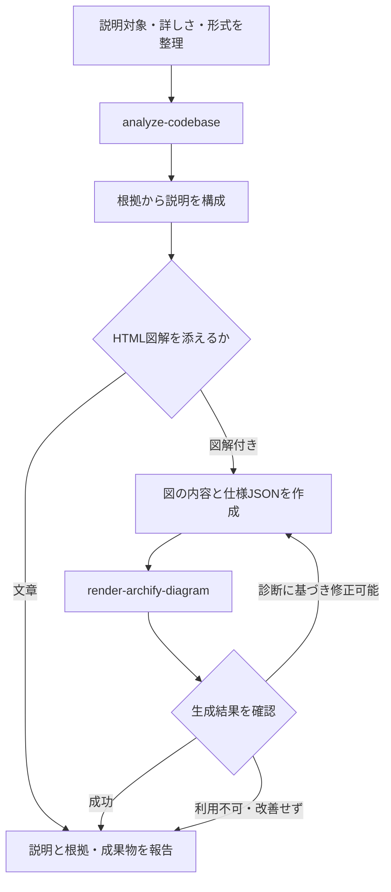

# Explain Implementation

現在の実装がどう動くかを、ユーザーの知りたい範囲と理解度に合わせて説明する。

## Internal Skills

このWorkflowの`SKILL.md`を含むディレクトリがsymlinkまたはJunctionの場合は、最初にリンク先の実体ディレクトリを解決する。`~/.agents/skills/explain-implementation`などの見かけのパスに対して`..`を解決しない。

実体ディレクトリを基準に、現在の実装を調査する前に次の内部Capabilityを最後まで読む。

- `../../capabilities/analyze-codebase/SKILL.md`

HTML図解を生成すると判断した場合だけ、実行前に次の内部Adapterを最後まで読む。

- `../../adapters/render-archify-diagram/SKILL.md`

同名のSkillをCodexのSkill一覧から探したり、ユーザー向けSkillとして起動したりしない。必須Capabilityが存在しない、または読めない場合は、そのパスを報告して停止する。Adapterが読めない場合の扱いはWorkflowで判断する。

## Flow

## Workflow

1. 質問から説明対象、知りたい振る舞い、詳しさ、出力形式を整理する。通常は文章で説明し、ユーザーがHTML図解を求めた場合や、複数の関係を図示すると理解が進む場合に図解を添える。文章のみ、Mermaidなどの指定があれば優先する。
2. `analyze-codebase`へ対象と質問を渡し、実装経路、関連ファイル、制約、不明点を受け取る。説明を左右する不足があれば対象を絞って追加調査する。資料やテスト上の期待と実装が食い違う場合は区別し、コードを読んだ事実を実行確認済みと表現しない。
3. ユーザーから見た振る舞いを先に説明し、入口から主要処理、データの保存や外部接続、結果が返るまでを根拠付きで組み立てる。質問に関係する分岐や失敗時の挙動を含める。単なるファイル一覧や、根拠のない設計意図の推測にしない。
4. 図解付きの場合は、調査結果から図の種類、ノード、関係、意味のあるラベルを決める。Adapterの入力契約に従い、インストール済みツールの対応スキーマと例を必要な分だけ読み、仕様JSONを作る。構造の依存方向と処理順を混同しない。未確認の関係は事実として描かず、文章で不明点を説明する。
5. `render-archify-diagram`へ種類、仕様JSON、HTML出力先、品質を渡す。成功時は文章と図の意味が一致するか確認する。診断が返ればWorkflowが仕様を修正して再実行する。意味を変えずに直せない場合や、2回連続で診断が改善しない場合は打ち切る。ツール不足時も含め、得られた文章説明と図解できなかった理由を報告する。図解が必須なら未完了部分と再開条件を明示する。
6. 現状の説明、主要なコードへのリンク、調査範囲と未確認事項を報告する。図解を生成した場合は仕様JSONとHTMLのパス、機械検証の結果、ブラウザ確認・見た目の確認の実施状況を添える。

## Boundaries

- 説明の依頼をコード修正や改善案の実装に拡大しない。ファイル生成は説明用の成果物に限り、既存成果物を無断で置き換えない。
- Archify本体の導入・更新やブラウザの起動を暗黙に行わない。
- 調査で分からない事実を埋めるために、図の見栄えを優先して関係を創作しない。
