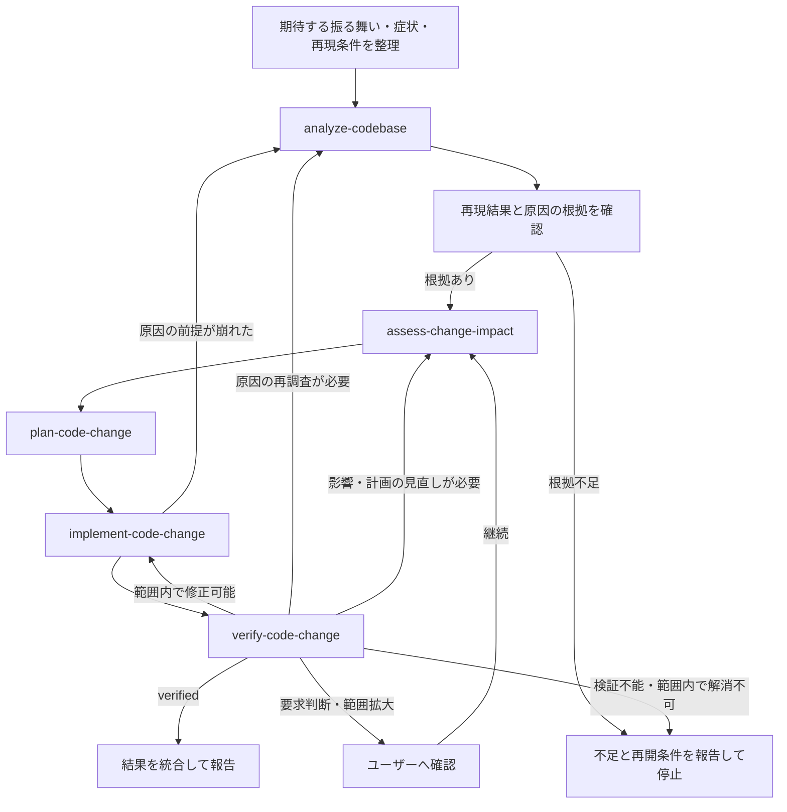

# Fix Bug

報告された不具合とコードの根拠を結び付け、期待する振る舞いを回復し、修正を確認可能な状態まで進める。

## Capabilities

次のCapabilityを利用可能なSkill一覧から読み込み、各Capabilityの指示に従う。

- `analyze-codebase`
- `assess-change-impact`
- `plan-code-change`
- `implement-code-change`
- `verify-code-change`

Capabilityの責務をこのWorkflow内で重複して定義しない。必要なCapabilityが利用できない場合は、不足しているSkillを報告して停止する。

## Flow

## Workflow

1. 期待する振る舞い、実際の症状、再現手順、入力や環境、対象外を依頼と利用可能な資料から整理する。修正の正否を左右する期待値が不明な場合だけユーザーへ確認する。
2. `analyze-codebase`へ症状と再現条件を渡し、関連する処理経路、実装、テスト、不明点を受け取る。修正前の再現結果やログを調査結果と照合し、症状を説明する原因の根拠を整理する。再現できない場合も、確認済みの事実と仮説を分け、修正を裏付ける根拠が不足していれば必要な入力や環境を報告して停止する。
3. `assess-change-impact`へ期待する振る舞い、現状調査、原因の根拠を渡し、修正対象と周辺の正常系への影響、互換性の制約を受け取る。
4. `plan-code-change`へここまでの結果を渡し、原因に対応する修正方針と検証方法を決める。元の症状が修正前に失敗し修正後に成功する確認方法と、影響を受ける正常系の確認を計画に含める。自動化できる場合は再発を検出する回帰テストを含め、難しい場合は代替の確認方法と限界を明示する。
5. `implement-code-change`へ修正計画を渡し、コードと必要なテスト、文書の変更を受け取る。原因の前提を覆す事実が返った場合は現状調査へ戻り、方針の変更が必要なら影響評価と計画を更新する。
6. `verify-code-change`へ期待する振る舞い、元の再現条件、修正前の結果、影響評価、実装結果を渡す。元の症状の解消と関連する正常系を検証し、結果に応じて次のように進める。
   - `verified`なら結果を統合して報告する。
   - 範囲内の実装修正で解決できる場合は検証結果を`implement-code-change`へ渡し、修正後に再検証する。
   - 原因や計画の前提が崩れた場合は現状調査または影響評価へ戻り、計画を更新する。
   - 新しい要求判断や範囲拡大が必要ならユーザーへ確認し、継続する場合は影響評価からやり直す。
   - 環境や入力の不足で検証できず、現在の範囲で解消できない場合は、未検証として不足と再開条件を報告する。同じ失敗に対して新しい根拠のない修正や再実行を繰り返さない。

## Boundaries

- 診断のみ、計画のみ、レビューのみの依頼を、コード修正へ拡大しない。
- 無関係なリファクタリングや、症状を隠すためだけの例外の握りつぶし、テストの削除・期待値の弱体化を修正に含めない。
- ユーザーの未コミット変更を上書きまたは破棄しない。
- 公開インターフェースや保存データの互換性を壊す必要が生じた場合は、実装前に確認する。
- コミット、push、PR作成、デプロイ、リリースは、ユーザーが明示的に依頼した場合だけ行う。

## Completion

完了または停止時は、次を簡潔に示す。検証できていない修正を、解消済みとは報告しない。

- 症状と期待する振る舞い
- 原因とその根拠、再現の可否
- 修正内容と主な変更箇所
- 元の症状と回帰に対して実行した検証、その結果
- 未検証事項、残存リスク、停止した場合の再開条件
