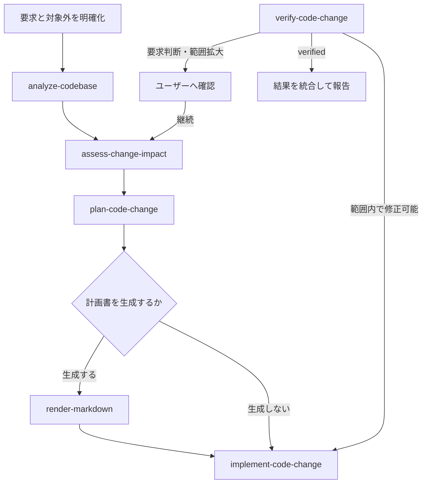

# Implement Feature

ユーザーが求める振る舞いを、既存リポジトリの規約と構造に沿って実装し、確認可能な状態まで進める。

## Internal Skills

このWorkflowの`SKILL.md`を含むディレクトリがsymlinkまたはJunctionの場合は、最初にリンク先の実体ディレクトリを解決する。`~/.agents/skills/implement-feature`などの見かけのパスに対して`..`を解決しない。

実体ディレクトリを基準に、次の内部Capabilityを最後まで読み、各指示に従う。

- `../../capabilities/analyze-codebase/SKILL.md`
- `../../capabilities/assess-change-impact/SKILL.md`
- `../../capabilities/plan-code-change/SKILL.md`
- `../../capabilities/render-markdown/SKILL.md`
- `../../capabilities/implement-code-change/SKILL.md`
- `../../capabilities/verify-code-change/SKILL.md`

同名のSkillをCodexのSkill一覧から探したり、ユーザー向けSkillとして起動したりしない。Capabilityの責務をこのWorkflow内で重複して定義しない。必要なファイルが存在しない、または読めない場合は、そのパスを報告して停止する。

## Flow

## Workflow

1. 依頼から、実装後に満たす振る舞いと対象外を明確にする。結果を大きく変える判断だけをユーザーへ確認する。
2. `analyze-codebase`を使い、現在の処理、責務、制約、関連テストを把握する。
3. `assess-change-impact`を使い、要求された変更の波及範囲、互換性、必要な対応を確認する。
4. `plan-code-change`を使い、要求、現状調査、影響評価から実装方針と検証方法を決める。
5. ユーザーが実装計画のMarkdownファイルを求めている場合は、`assets/implementation-plan/schema.json`を読み、`plan-code-change`の結果を入力契約へ対応付けたJSONを用意する。`render-markdown`へそのスキーマ、`assets/implementation-plan/template.md`、JSON、出力先を渡す。出力先はユーザーの指定またはリポジトリの既存規約から決め、計画ファイルを変更対象に含める。既存ファイルの置換が依頼範囲に含まれない場合は置換しない。
6. `implement-code-change`を使い、計画に沿って一貫した変更を実装する。
7. `verify-code-change`を使い、実装結果を検証する。範囲内の修正で解決できる問題は、検証結果を`implement-code-change`へ渡して修正し、再検証する。新しい要求判断や範囲拡大が必要ならユーザーへ確認し、継続する場合は影響評価からやり直す。
8. 各Capabilityの結果を統合し、実装結果と検証結果を報告する。計画書を生成した場合は、その出力先も示す。

## Boundaries

- 診断のみ、計画のみ、レビューのみを求められた場合は、それぞれの依頼範囲を越えて実装しない。
- コミット、push、PR作成、デプロイ、リリースは、ユーザーが明示的に依頼した場合だけ行う。
- リポジトリにある未コミットの変更はユーザーの作業として扱い、上書きまたは破棄しない。
- 要求を満たすために公開インターフェースや保存データの互換性を壊す必要が生じた場合は、実装前に確認する。

## Completion

完了時は、次を簡潔に示す。

- 実現した振る舞い
- 主な変更箇所
- 生成した実装計画書のパス（生成した場合）
- 実行した検証と結果
- 未検証事項または残存リスク
